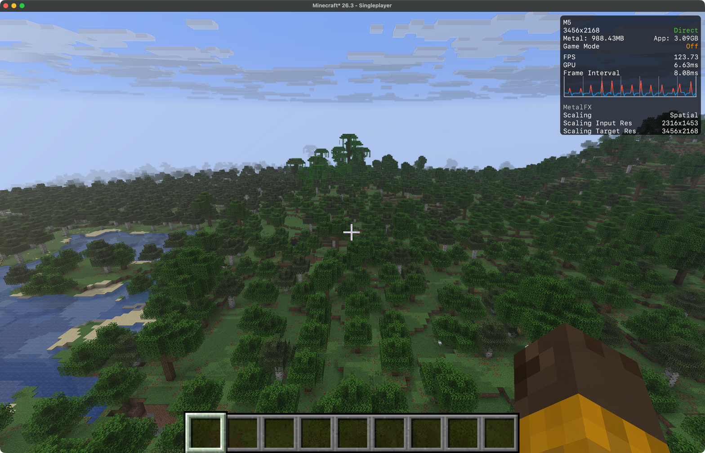

# Tilelight

A Metal renderer for Minecraft Java Edition 26.3 on Apple Silicon. Working name.

Minecraft keeps its own Vulkan (MoltenVK) renderer for the GUI, entities and
presentation. Tilelight takes over parts of each frame on Metal, sharing images
with Vulkan and handing off through GPU-side events (no CPU waits):

- **Opaque terrain** drawn and lit on Metal: sky light, shadow-mapped sun,
  block light, vanilla-matching fog.
- **Sun shadows** from a 2048² shadow map drawn straight from Minecraft's
  chunk buffers.
- **Volumetric haze and sun shafts**, ray-marched through the shadow map.
- **Water reflections** in screen space, with a sky fallback and Fresnel.
- **Render scale + anti-aliasing:** our TAA at internal resolution plus MetalFX
  spatial upscaling by default; MetalFX temporal or spatial-only as options.

On a base M5 MacBook Pro at native 3456×2168, render distance 16, all of the
above runs at ~133 fps on the reference scene with TAA (~147 fps without
anti-aliasing), against ~160-168 fps for vanilla. Details, measurements and the reasoning behind every
choice: [docs/ARCHITECTURE.md](docs/ARCHITECTURE.md).



## Use

1. Minecraft 26.3, Fabric Loader 0.19.5+, Fabric API.
2. Set **Graphics API to Vulkan** in Minecraft's video settings. Tilelight
   stays off on OpenGL.
3. Put `build/libs/tilelight-0.0.1.jar` in `mods/`.
4. Optionally add `--enable-native-access=ALL-UNNAMED` to the JVM arguments to
   silence Java's native-access warning.

Settings live in `config/tilelight.json` (written on first run):

| Key          | Default   | Meaning                                                         |
|--------------|-----------|-----------------------------------------------------------------|
| `upscaler`   | `taa`     | `taa` (anti-aliased, ~0.75 ms), `metalfx` (spatial only, fastest), `temporal` (sharpest, ~5 ms), `bilinear`, `off` |
| `renderScale`| `0.67`    | fraction of the window the world renders at                    |
| `terrain`    | `true`    | Metal terrain and lighting (otherwise vanilla terrain + shadow overlay) |
| `sameQueue`  | `true`    | run on MoltenVK's queue (faster); `false` uses a separate queue |
| `shadows`, `volumetric`, `water` | `true` | effects                               |
| `fogDensity` | `0.004`   | haze density per block                                          |

Not compatible with Sodium, Iris or other mods that replace terrain rendering.

## Build

Needs Xcode (for `clang` and the Metal compiler) and JDK 25.

```sh
./gradlew build   # jar in build/libs, runs the GPU tests in src/test
```

Benchmarks: [tools/bench](tools/bench). Raw results are in `tools/bench/results`.

## License

[Apache-2.0](LICENSE)
